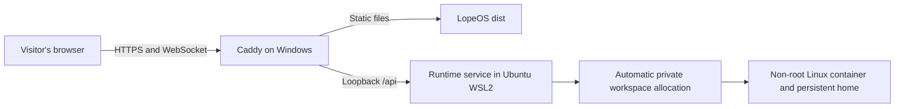

# Windows + Caddy: no setup for visitors

The website now automatically creates a private guest workspace on first use of
Terminal or Files. Visitors install nothing, paste no token, and do not need an
account. They use the same HTTPS origin for the desktop, files, and terminal
WebSocket. Setup belongs to the Windows hosting machine once, when publishing.



The runtime keeps real Bash/zsh, Python, Node, pipelines, signals, job control,
ANSI output, and shared persistent files. This is a hosted Linux execution
service; it does not require the visitor to run Linux, Docker, WSL, or Node.
The visitor's browser can be on Windows, macOS, Linux, a tablet, or a phone with
a modern browser. Keyboard/clipboard behavior still follows browser permissions
and available input devices.

## Windows host preparation

Use a Windows installation supporting WSL2, an Ubuntu WSL2 distribution with
systemd, Node 24+, gVisor, and **Docker Engine installed inside that Ubuntu distribution**.
Do not use Windows containers or Docker Desktop's separate daemon for this
allocator: the loop-backed quota filesystems and Docker bind mounts must share
the same Linux host namespace. Host checks reject the wrong daemon. Install the
Ubuntu build tools (`build-essential`, `python3`) and filesystem tools
(`e2fsprogs`, `mount`) if they are absent.

These are hosting prerequisites, not visitor requirements. Caddy continues to
run natively on Windows. Windows can reach WSL services through localhost;
keep WSL localhost forwarding enabled (or use mirrored networking). Only Caddy's
HTTPS endpoint needs public access; runtime port 4174 stays on loopback.

Official host setup references:
[install WSL](https://learn.microsoft.com/en-us/windows/wsl/install),
[WSL systemd](https://learn.microsoft.com/en-us/windows/wsl/systemd),
[WSL networking](https://learn.microsoft.com/en-us/windows/wsl/networking), and
[Ubuntu Docker Engine](https://docs.docker.com/engine/install/ubuntu/).

## Publish on your host

Build this repository using its normal package manager:

```powershell
pnpm install
pnpm build
```

In an elevated PowerShell **under the Windows user who owns the Ubuntu distro**,
run the included host configurator with the eventual real website origin:

```powershell
.\services\runtime\windows\Configure-LopeRuntime.ps1 `
  -SiteOrigin https://lope.example.com `
  -Distro Ubuntu `
  -RegisterStartupTask
```

The script copies runtime source into Ubuntu's native `/opt/lopeos-runtime`,
installs its dependencies and the official signed gVisor package, configures the
dedicated isolation runtime, builds the Linux workspace image once, verifies
a real PTY inside that sandbox, and installs and
starts `lope-visitor-runtime.service`, and generates a concrete
`Caddyfile.windows.generated` pointing to this checkout's `dist`. Review that
file and use it with your Windows Caddy service. It does not overwrite your
existing Caddy configuration or open firewall/router ports. Point the domain
and normal HTTPS ingress at Caddy as part of hosting the website.

The optional startup task runs as the distro's Windows owner, not SYSTEM, and
keeps WSL running across Windows startup. WSL systemd services by themselves do
not replace this host lifecycle handling. The task uses Windows S4U and never
stores a password in this repository. Its registration and actual unattended
startup must be verified on the target Windows machine.

The source Caddy template is `services/runtime/windows/Caddyfile`. It serves
only the built `dist`, forwards `/api/*` to `127.0.0.1:4174`, preserves Origin
and visitor cookies, and supports terminal WebSocket upgrades. **Do not inject
`.runtime/token` or a shared Authorization header into this public route.**
That token belongs to private single-user development. Also do not publish
Vite's development server or serve the repository root.

## Terminal host isolation

Every workspace now requires the verified gVisor `lope-sandbox` runtime. Host
files/drives, sockets, processes, devices, network namespaces and credentials
are excluded. The controller refuses execution and stops an owned unsafe
container when checks fail. There is no host-shell or plain-container fallback.
See [the enforced boundary and host-canary test](runtime-isolation.md). Existing
older containers must be recreated while retaining their home images.

## Automatic behavior

On the first unauthenticated workspace request, the shared client calls
`POST /api/visitor`. The backend sets an opaque, signed, Secure, HttpOnly,
SameSite=Lax host cookie, stores the owner assignment privately, and starts one
Linux workspace. The UI waits for startup automatically. Concurrent requests
from Terminal, Files, and Editor share one bootstrap operation. Subsequent
HTTP requests and WebSocket attachments authenticate from that cookie. Tokens
and signing keys are never sent to application JavaScript or localStorage.

The allocator creates a persistent, size-limited home and a non-root container
on the host, validates its isolation, and starts the real PTY agent. A returning
visitor reuses the same workspace. A stopped workspace is remounted and resumed
before file operations begin. Each browser profile has a separate guest
identity. Clearing the site cookie loses access to that anonymous workspace;
files can be exported through Files before clearing site data. Cross-device
account sync is not implied by anonymous visitor access.

Disconnected workspaces stop after 15 minutes of inactivity to release compute.
Files persist independently. Default guest retention is 30 days since activity;
expired identities are revoked before their containers and disk images are
removed. Signing keys and assignments persist under `/var/lib/lopeos/control`,
outside every sandbox, so restarting the Windows/WSL service preserves identity.
Unfinished cleanup is retried without assigning another visitor the old files.
Workspace containers do not auto-start against unmounted home directories after
reboot; the allocator mounts their quota filesystems before starting them.

The site has bounded capacity and anonymous abuse controls. Defaults allow 8
simultaneously running workspaces, 128 retained visitors, and 512 MiB of home
storage each. A full server reports a queue state and the client retries while
capacity becomes available. Provision host memory/disk for the desired traffic;
these are adjustable limits, not a promise of unlimited concurrent execution.
Budget WSL memory for the selected active workspace count plus the controller,
or lower `LOPE_MAX_ACTIVE` on a smaller Windows host.
The existing container networking restriction remains in place.

## Host configuration

Edit `/etc/lopeos/visitors.env` inside Ubuntu, then restart the service. The
installer preserves an existing environment file on upgrades.

| Variable | Default | Purpose |
| --- | --- | --- |
| `LOPE_ALLOWED_ORIGINS` | Host configurator's exact HTTPS origin | Public website origin; no wildcards. |
| `LOPE_RUNTIME_HOST`, `LOPE_RUNTIME_PORT` | `127.0.0.1`, `4174` | Private listener reached by Windows Caddy. |
| `LOPE_STATE_DIR` | `/var/lib/lopeos` | Native Linux storage for private identity state and quota disk images. |
| `LOPE_MAX_ACTIVE` | `8` | Concurrent Linux workspace cap. |
| `LOPE_MAX_VISITORS` | `128` | Retained anonymous workspace cap. |
| `LOPE_STORAGE_MB` | `512` | Capacity of each new persistent home image. |
| `LOPE_GUEST_RETENTION_DAYS` | `30` | Inactive guest retention, 1..365 days. |
| `LOPE_WORKSPACE_IDLE_MS` | `900000` | Stop workspaces without connected viewers or recent requests. |
| `LOPE_TRUST_PROXY` | `1` in host installer | Accept Caddy's client-IP header only through loopback; Caddy overwrites that header. |
| `LOPE_VISITOR_SECURE_COOKIE` | enabled | Set to `0` only for loopback HTTP tests; nonlocal insecure origins are rejected. |
| `LOPE_WORKSPACE_IMAGE` | `lope-workspace:local` | Prebuilt sandbox image. |

For this deployment start `public-server.js`, not the private registry-only
`server.js`. `server.mjs` also selects public mode when
`LOPE_PUBLIC_VISITORS=1`. The bundled installer chooses the correct entry.
Browser/Chromium services must use the same server-resolved visitor identity
with separate per-visitor profiles; a shared browser profile/token must never be
exposed through this gateway. The runtime's browser file-transfer bridge remains
available for that service integration.

## Verification

Automated tests cover first-visit creation with no token, concurrent automatic
client startup, persistent cookies and identities, HTTP/WS owner isolation,
CSRF/origin checks, allocation deduplication/capacity, and revoke-before-delete
retention. Existing actual PTY, filesystem, Unicode, signal, resize and replay
tests remain in the suite. The production website build passes. The current combined unit suite reports
47 passed and 3 live Linux/gVisor tests skipped. Chromium additionally passed automatic
startup, a real pipeline, Terminal→Files→Text Editor→Terminal, refresh
reattachment, and isolation between two browser contexts using a disposable
native PTY/filesystem fixture. Reproduce that browser check after a build with
`node services/runtime/visitor-browser.mjs`. The screenshot is
`docs/screenshots/terminal-visitor.png`; it records that native test fixture,
not a deployed Linux workspace.

This development machine is macOS without WSL, Docker, Caddy, or PowerShell.
Therefore this change is **implemented and locally tested, not activated on a
Windows server**. Before opening the public host, run the real Linux acceptance
suite there and verify Caddy HTTPS/WebSockets, automatic new/returning visitor
workspaces, two-browser isolation, quota enforcement, reboot recovery, and the
scheduled task. Those platform checks cannot be represented as passed here.
